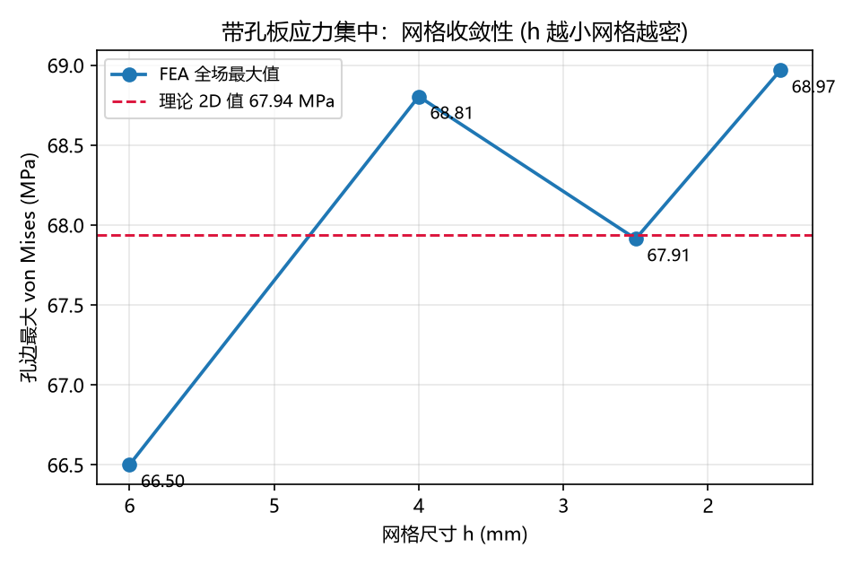
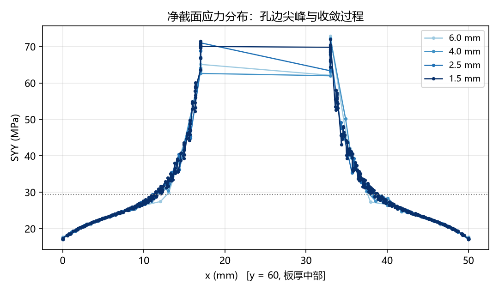
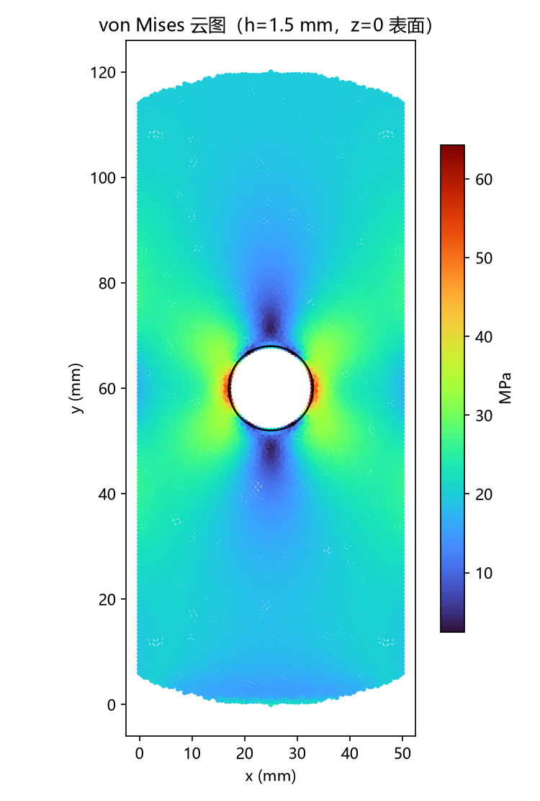

# 003 带孔板应力集中与网格收敛 — 计算书

日期：2026-11-14　工具链：FreeCAD 1.1.4 + Gmsh 4.15.0 + CalculiX 2.23（ccx_dynamic）
单位制：**mm-N-MPa**（长度 mm，力 N，应力 MPa，密度 t/mm³）

---

## 1. 项目概述

一个中心开圆孔的矩形板，上下两端受均布拉力，经典应力集中问题（Kirsch/Howland 解）。本算例的目的不是算出一个新结果，而是**练两件事**：

1. 从零走完「建模 → 材料 → 边界/载荷 → 网格 → 求解 → 后处理」全流程；
2. **做网格收敛性分析**，用四档网格证明结果与网格无关，并量化粗网格的误差。

孔边应力集中是有限元里最容易被“网格骗”的场景：粗网格常常给出漂亮但错误的结果，加密后数值可能偏大也可能偏小，不做收敛就无法判断可信度。

## 2. 几何

| 项目 | 数值 |
|---|---|
| 板长（X） | 50 mm |
| 板宽（Y，加载方向） | 120 mm |
| 板厚（Z） | 10 mm |
| 通孔直径 | Ø16 mm（半径 8） |
| 孔心位置 | (25, 60)，位于板的对称中心 |
| 净截面宽度 | 50 − 16 = 34 mm |
| 实体体积 | 57 989.4 mm³（`Cut.Shape.Volume`） |
| 表面积 | 15 500.6 mm²（`测量→面积`，与解析式一致，证明孔已贯穿） |

几何由 Part 工作台的 Box（50×120×10）+ Cylinder（R8，H20，置于 (25,60,−5)）布尔切割得到，对象 Label 改为 ASCII 名 `Plate`（内部 Name 仍为 `Cut`）。

## 3. 材料

**CalculiX-Steel**（FreeCAD 内置材料卡）：

| 参数 | 数值 |
|---|---|
| 弹性模量 E | 210 000 MPa |
| 泊松比 ν | 0.30 |
| 密度 ρ | 7900 kg/m³（= 7.9e-9 t/mm³） |

线弹性、各向同性、小变形假设。来源：FreeCAD 材料库 `CalculiX-Steel`，数据为通用结构钢标称值，未做材料试验标定。

## 4. 边界条件与载荷

| 项目 | 设置 |
|---|---|
| 固定 | 底面 y=0（几何 Face2，面积 500 mm²）全约束 U1=U2=U3=0 |
| 载荷 | 顶面 y=120（几何 Face4，面积 500 mm²）均布压力 20 MPa，方向 +Y |
| 合力校核 | 20 MPa × 500 mm² = **10 000 N** |
| 加载方式 | 面压力 `*DLOAD`（P1 面载荷），未用节点力——节点力会在加载面边缘引入虚假集中（见 AGENTS.md §6 第 2 条） |

**理论参考值**：

- 毛截面应力 σ_gross = 10 000 / (50×10) = **20.00 MPa**
- 净截面应力 σ_nom = 10 000 / (34×10) = **29.41 MPa**
- 应力集中系数（净截面，d/W = 0.32）：
  Kt = 2 + (1 − d/W)³ = 2 + (1 − 0.32)³ = **2.31**
- 峰值应力 σ_max = Kt · σ_nom = **67.94 MPa**
- 交叉校核：Peterson/Howland 拟合式
  Kt = 3 − 3.13(d/W) + 3.66(d/W)² − 1.53(d/W)³ = **2.323**（差 0.6 %，可认为一致）

## 5. 网格与求解

单元类型 **C3D10**（10 节点二次四面体），Gmsh 生成、FreeCAD FEM 求解。

| 档 | 全局尺寸 h | 孔边加密 | 节点 | 三维单元 | 方程数（约） |
|---|---|---|---|---|---|
| 1 | 6 mm | 无 | 4 417 | 2 243 | ~13 000 |
| 2 | 4 mm | 无 | 9 502 | 5 063 | ~29 000 |
| 3 | 2.5 mm | 无 | 31 951 | 19 065 | ~96 000 |
| 4 | 1.5 mm | 无 | 132 351 | 85 930 | ~400 000 |

四档全部**一个增量步收敛**（`.sta`：`STEP 1, INC 1, ITRS 1`），无迭代困难——纯线弹性、无接触，符合预期。最大网格畸变（Gmsh worst distortion）：6 mm 0.483、4 mm 0.730、1.5 mm 更优，质量合格。

> 说明：本算例的“孔边加密”没有单独设置 MeshRegion，加密是靠全局尺寸减小实现的。这样更简单，也更能暴露全局网格对峰值的影响；代价是单元数增长快（h 从 6→1.5，单元数涨 38 倍）。

## 6. 结果与网格收敛

### 6.1 四档峰值汇总

| 档 | h | 节点 | 三维单元 | 全场 σ_max | 等效 Kt = σ_max/σ_nom | 相对理论 2.31 | 峰值位置 (x,y,z) |
|---|---|---|---|---|---|---|---|
| 1 | 6 mm | 4 417 | 2 243 | 66.50 MPa | 2.261 | −2.1 % | (33.00, 60.00, 5.00) |
| 2 | 4 mm | 9 502 | 5 063 | 68.81 MPa | 2.339 | +1.3 % | (33.00, 60.00, 5.00) |
| 3 | 2.5 mm | 31 951 | 19 065 | 67.91 MPa | 2.309 | −0.0 % | (32.98, 60.59, 1.92) |
| 4 | 1.5 mm | 132 351 | 85 930 | **68.97 MPa** | **2.345** | **+1.5 %** | (17.01, 59.62, 4.37) |

**收敛判定**：后三档（4 / 2.5 / 1.5 mm）为 68.81、67.91、68.97 MPa，均值 **68.56 MPa**，极差 ±0.53 MPa（**±0.8 %**）。相邻两档变化 +1.55 %。按“最后两档相对变化 < 2 %”的工程判据，**可认为已收敛**，取

> **σ_max = 68.6 ± 0.6 MPa，等效 Kt = 2.33 ± 0.02**

第 1 档（6 mm）与收敛值差 **−3.1 %**，属于**不可用**的粗网格；这也是不能用「跑一档就交差」的实证。

### 6.2 净截面应力分布

y=60 净截面、板厚中部的 SYY：远离孔处约 20 MPa（毛截面），向孔边急剧升至 ~70 MPa（右孔边 x≈33）。四档曲线在离孔 >15 mm 处几乎重合，仅在孔边 2–3 mm 内分叉——**说明加密的意义集中在孔边，远处粗网格完全够用**。

### 6.3 von Mises 云图（最细网格，z=0 表面）

红色双叶位于孔左右两侧（拉伸方向垂直），蓝色区位于孔上下两侧（受压），与经典解一致。

### 6.4 三维效应：沿板厚的应力分布

最细网格下，孔右侧边缘（x≈33, y≈60）沿厚度方向的 σ_vm：

| z (mm) | 0（表面） | 1.0 | 2.0 | 3.0 | 5.0（中面） | 6.0 | 8.0 | 9.0 | 10（表面） |
|---|---|---|---|---|---|---|---|---|---|
| σ_vm (MPa) | 64.3 | 67.6 | 67.4 | 67.3 | 67.9 | **68.1** | 67.6 | 67.2 | 64.4 |

- **自由表面（z=0/10）比内部低约 5 %**：自由表面 σz=0（平面应力），中面受邻层约束 σz>0（接近平面应变），von Mises 在中面偏高。
- 这说明**“峰值出现在板厚中部”**，也解释了为什么粗网格（厚度方向只有 2–3 层单元）会把峰值算到 z=5 而漏掉表面梯度。
- 二维理论 2.31 对应**平面应力/无限宽板**，与三维厚板的中面峰值不是同一件事，所以 +1.5 % 的偏差是**模型维度差异**，不是计算错误。

## 7. 结论

1. 带孔板在 10 kN 拉伸下，**孔边最大 von Mises = 68.6 ± 0.6 MPa**，等效 Kt = **2.33**，与二维理论 2.31 相差 **+1.5 %**，工程精度内一致。
2. 网格**已收敛**：4 / 2.5 / 1.5 mm 三档互相差 <1 %；6 mm 粗网格低估 3.1 %，不可用。
3. 孔边峰值出现在**板厚中部**；自由表面低约 5 %，是板材三维约束（平面应变 vs 平面应力）所致。
4. 载荷通过面压力施加，合力 10 kN 与加载面平均 SYY=20.00 MPa 完全吻合，**载荷映射无误**。
5. 线弹性、小变形、无自重、理想圆柱孔、材料各向同性——这些假设对薄板、低应力水平合理；若用于疲劳寿命评估，需注意 68.6 MPa 是**名义弹性应力**，缺口塑性、表面粗糙度、尺寸效应都未计入。

## 8. 复现方式

| 步骤 | 命令/操作 |
|---|---|
| 几何 | FreeCAD GUI：Box + Cylinder → 布尔切割 → Label 改 `Plate`，存 `01-几何\带孔板.FCStd` |
| 材料/边界/载荷 | FEM 工作台 + Python 控制台（GUI 命令在本版本发灰，见 §9 已知坑） |
| 生成 .geo | `GmshTools(mesh).prepare()`（只写 brep+geo，不跑 gmsh） |
| 划分网格 | `F:\FreeCAD\bin\gmsh.exe shape2mesh.geo -3 -format unv -o Cut_Mesh.unv` |
| 导入网格 | `mesh.FemMesh = Fem.read(<unv>)`，再 `doc.recompute()` |
| 求解 | `run.run_fem_solver(solver, working_dir=..., blocking=True)` |
| 后处理 | `03-计算\summary_table.py`（四档汇总）、`03-计算\make_figs.py`（出图） |

中间产物：`04-结果\levelN_*.{inp,frd,unv}`（四档全留档），`04-结果\figs\*.png`。

## 9. 已知坑（本次新增）

1. **FreeCAD 1.1 的 Gmsh 包装不可用**：`GmshTools.create_mesh()` 走 QProcess 异步，返回 None 也不报错；其内部命令 `gmsh -v 3 - shape2mesh.geo` 里那个 `-` 参数在 Windows 下导致 gmsh 什么都不生成。→ 改为「`prepare()` 写 geo + 命令行跑 gmsh + `Fem.read` 导回」。
2. **FEM 的 GUI 命令常发灰**（新建分析、材料子菜单）：与焦点/任务对话框状态有关。→ 用 Python 控制台 `ObjectsFem.makeAnalysis` / `makeMaterialSolid` / `makeSolverCalculiXCcxTools` 绕过。
3. **`addObject` 必须显式调用**：控制台建的 Material/网格/求解器默认与 `Analysis` 平级（游离），必须 `Analysis.addObject(obj)` 才参与求解。
4. **首选项里的求解器路径与工作目录会残留旧绝对路径**：`ccxBinaryPath`、`CustomDirectoryPath` 必须逐个核对，否则要么用错 ccx 版本，要么结果落到旧项目目录。
5. **中文路径**：本例工程目录含中文，Gmsh 命令行 + `Fem.read` 全程正常（几何对象名用 ASCII `Plate`，unv 内部无中文）。但 `.geo` 里的物理组名、inp 的 ELSET 名都保持 ASCII，避免跨工具解析问题。
