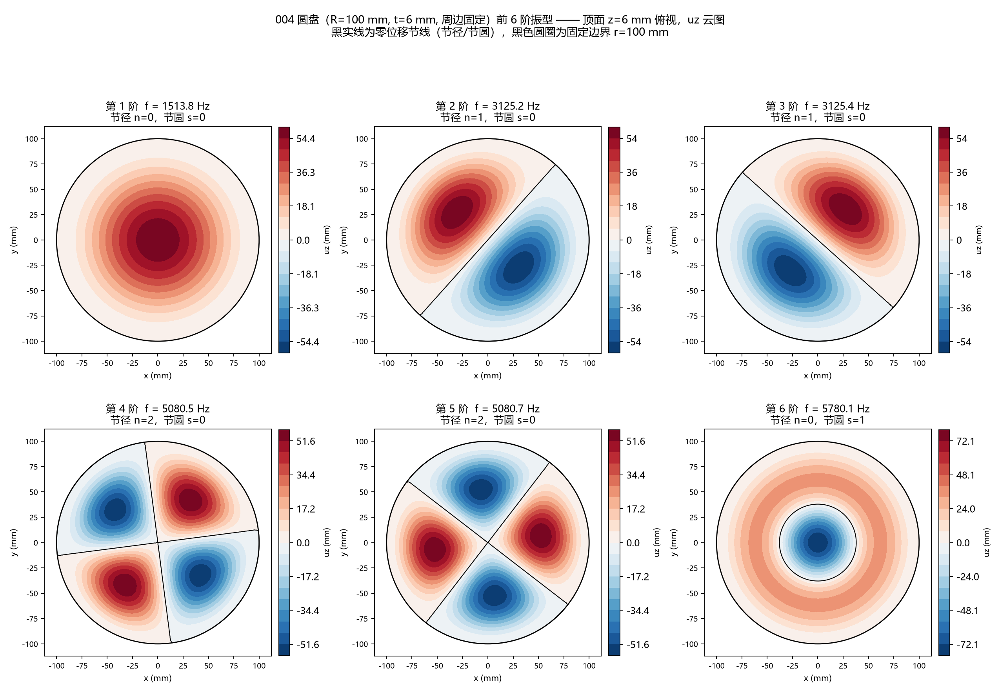
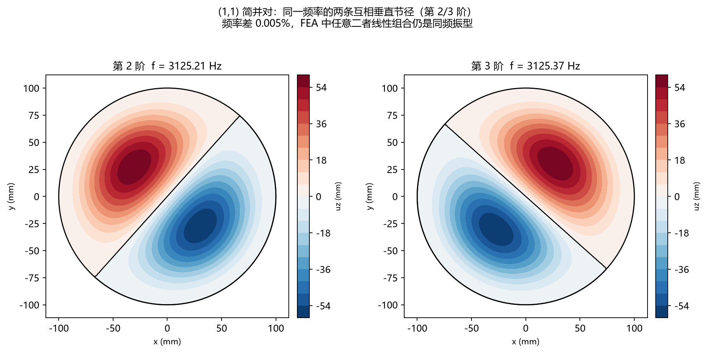
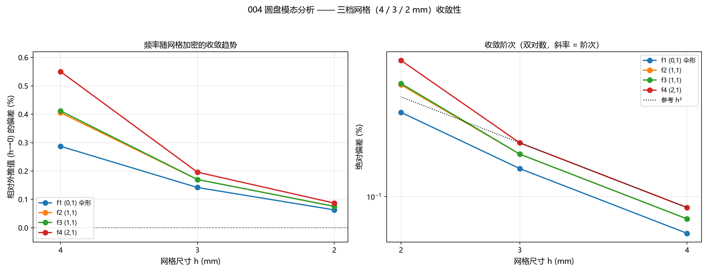

# 004 圆盘模态分析 — 计算书

日期：2026-11-16　工具链：FreeCAD 1.1.4 + Gmsh 4.15.0 + CalculiX 2.23（ccx_dynamic）
单位制：**mm-N-MPa**（长度 mm，力 N，应力 MPa，密度 t/mm³ = 7.9e-9）

---

## 1. 项目概述

半径 100 mm、厚 6 mm 的钢圆盘，**外圆柱面（r = 100）全固定**，上下圆面自由，求前 10 阶固有频率与振型。

模态分析是前三个静力算例**碰不到**的一类问题：它没有载荷，只有质量矩阵与刚度矩阵的广义特征值问题 `(K − ω²M)φ = 0`。数据链路上有两处和静力分析不同，也是本算例主要的练手点：

1. **材料必须有密度**，否则质量矩阵为零，频率全是 0 或直接报错；
2. 结果不在 `.frd` 的应力场里，而在 `.dat` 的本征值表和 `.frd` 的位移场里，振型要从位移场重新画。

选圆盘的理由：振型用**节径数 n / 节圆数 s** 描述，是有精确解析解的经典问题（Leissa《Vibration of Plates》），能定量校核；同时前 10 阶里含 4 组**双重简并**，是模态分析最容易看错的地方。

## 2. 几何

| 项目 | 数值 | 校核 |
|---|---|---|
| 半径 R | 100 mm | 侧面面积 2πRt = 3769.911 mm² |
| 厚度 t | 6 mm | 上下圆面各 πR² = 31 415.927 mm² |
| 体积 | 188 495.559 mm³ | 解析 πR²t = 188 495.559 ✓ |
| 表面积 | 66 601.764 mm² | 解析 2πR² + 2πRt = 66 601.765 ✓ |
| 面数 | 3（侧面 + 上下圆面） | Face1 侧面 / Face2 z=0 / Face3 z=6 |

几何文件 `01-几何\Disc.FCStd`，对象名 **ASCII**（`Disc`）——中文名会让 Gmsh 报 `Unable to open file`（AGENTS.md §6 #13）。

**边界条件的几何口径**：约束加在**圆柱侧面**（Face1）的全部三个平动自由度上。这与「边缘夹支圆板」的解析边界并非严格等价——Kirchhoff 理论假设中面内径向位移自由、只约束 w 和转角；三维实体把侧面的 ur、uθ、uz 全固死，等于额外加了径向薄膜约束，**结果偏刚**。

## 3. 材料

CalculiX-Steel（FreeCAD 内置材料卡）：

| 参数 | 数值 |
|---|---|
| 弹性模量 E | 210 000 MPa |
| 泊松比 ν | 0.30 |
| **密度 ρ** | **7900 kg/m³ = 7.9e-9 t/mm³** |

密度是模态分析的必需项。FreeCAD 会按 `analysis_type == "frequency"` 自动判定需要密度（`Fem/femsolver/calculix/write_femelement_material.py:38-40` 的 `is_density_needed()`），并用 `FreeCAD.Units.Quantity(...).getValueAs("t/mm^3")` 自动换算单位（同文件 `:70-73`），所以材料卡里写 `7900 kg/m^3` 是安全的，生成的 `.inp` 里是 `*DENSITY 7.9E-09`。

模型总质量 = 188 495.559 mm³ × 7.9e-9 t/mm³ = **1.46853e-3 t**，与 CalculiX 输出 `TOTAL EFFECTIVE MASS 0.1468530E-02` 一致 ✓。

## 4. 网格

Gmsh 生成的 2 阶四面体网格（C3D10 = 10 节点二次四面体），全局特征尺寸三档：

| 档 | 全局尺寸 | 节点 | C3D10 单元 | 固定节点数 |
|---|---|---|---|---|
| 粗 | 4 mm | 34 618 | 17 374 | 1 584 |
| 中 | 3 mm | 74 901 | 41 607 | 2 104 |
| 细 | 2 mm | 218 187 | 131 577 | 5 678 |

主算例（4 mm 档，GUI 生成、存进 `Disc.FCStd` 的那份）为 34 664 节点 / 17 410 单元 / 11 310 面，与脚本档（34 618 / 17 374）差 0.13%，源于 gmsh 曲率加密参数微差，两者均合格。

生成方式：`网格 → 从形状生成网格（Gmsh）`，最大 4 mm、最小 0.2 mm、阶次 2nd，点 **Apply**（不是 OK）生成。三档收敛对比用 `03-计算\mesh_conv.py` 从同一份 `.brep` 重新划分并直接跑 ccx。

## 5. 边界条件与求解设置

| 项目 | 设置 |
|---|---|
| 约束 | 圆柱侧面 Face1 全固定（Ux = Uy = Uz = 0） |
| 载荷 | 无 |
| 求解器 | CalculiX 2.23，`*FREQUENCY 10, 0.0, 1000000.0` |
| 特征模态数 | 10（`EigenmodesCount = 10`，FreeCAD 默认值） |

`.inp` 关键卡片逐条核对（各出现 1 次，无重复）：

```
*ELASTIC
210000,0.3
*DENSITY
7.9E-09
*BOUNDARY
ConstraintFixed,1
ConstraintFixed,2
ConstraintFixed,3
*STEP
*FREQUENCY
10,0.0,1000000.0
*OUTPUT, FREQUENCY=1
*END STEP
```

求解日志：`Total CalculiX Time: 6.483148`、`CalculiX done without error!`。日志里的 `*WARNING: not all frequencies in the requested range found, increase the number of requested frequencies` 是阶数取满时的正常提示（最后一个本征值落在区间边界），不影响结果。

## 6. 结果

### 6.1 前 10 阶频率（4 mm 网格）

| 阶 | f (Hz) | (n, s) | 振型 |
|---|---|---|---|
| 1 | 1513.82 | (0, 1) | 伞形，中心一个波峰、无节线 |
| 2 | 3125.21 | (1, 1) | 一条节径 |
| 3 | 3125.37 | (1, 1) | 一条节径（与第 2 阶互相垂直） |
| 4 | 5080.46 | (2, 1) | 两条节径（十字） |
| 5 | 5080.71 | (2, 1) | 两条节径（十字，转 45°） |
| 6 | 5780.10 | (0, 2) | 一圈内部节圆，内外反相 |
| 7 | 7358.59 | (3, 1) | 三条节径 |
| 8 | 7358.89 | (3, 1) | 三条节径 |
| 9 | 8729.33 | (1, 2) | 一条节径 + 一圈内部节圆 |
| 10 | 8729.98 | (1, 2) | 一条节径 + 一圈内部节圆 |

`n, s` 不是我读图猜的，而是程序自动检测（`03-计算\make_mode_figs.py`）：n = 在 r = 78 mm 的环上沿 θ 走一圈，数 uz 变号次数再除以 2；s = 先找该振型振幅最大的方位角 θ0，沿 θ0 半径走到 0.97R 数零交叉。10 阶结果与理论 (n, s) 全部吻合。



### 6.2 与薄板理论对账

理论值由**夹支圆板**频率方程 `J_n(λ)·I_n′(λ) − I_n(λ)·J_n′(λ) = 0` 求根，`f = (λ²/2πa²)·√(D/ρt)`，`D = Et³/12(1−ν²)`。本模型 a = 100 mm、t = 6 mm、a/t = 16.7、D = 4 153 846 N·mm、√(D/ρt) = 9.3613×10⁶ mm²/s。

Mindlin 中厚板修正（计入横向剪切与转动惯量）：`f_M = f_K / √(1 + (λ²/a²)·D/(κGt))`，κ = 5/6、G = E/2(1+ν) = 80 769 MPa。

| 阶 | FEA (Hz) | Kirchhoff | Mindlin | 对 Kirchhoff | 对 Mindlin | (n,s) |
|---|---|---|---|---|---|---|
| 1 | 1513.82 | 1522.05 | 1514.11 | −0.54% | **−0.02%** | (0,1) |
| 2 | 3125.21 | 3167.58 | 3133.50 | −1.34% | −0.26% | (1,1) |
| 3 | 3125.37 | 3167.58 | 3133.50 | −1.33% | −0.26% | (1,1) |
| 4 | 5080.46 | 5196.31 | 5105.54 | −2.23% | −0.49% | (2,1) |
| 5 | 5080.71 | 5196.31 | 5105.54 | −2.22% | −0.49% | (2,1) |
| 6 | 5780.10 | 5925.48 | 5807.88 | −2.45% | −0.48% | (0,2) |
| 7 | 7358.59 | 7602.94 | 7410.94 | −3.21% | −0.71% | (3,1) |
| 8 | 7358.89 | 7602.94 | 7410.94 | −3.21% | −0.70% | (3,1) |
| 9 | 8729.33 | 9062.85 | 8791.98 | −3.68% | −0.71% | (1,2) |
| 10 | 8729.98 | 9062.85 | 8791.98 | −3.67% | −0.71% | (1,2) |
| — | 平均 | — | — | **−2.39%** | **−0.48%** | |

**读法**（这段是本次最有价值的结论）：

- **对 Kirchhoff 系统性偏低 2.4%，且偏差随阶次单调增大**：一阶 −0.54%，到 9/10 阶已 −3.7%。这不是网格误差（网格收敛性见 §6.4，残差 < 0.1%），而是 **a/t = 16.7 的剪切变形效应**——Kirchhoff 假设无剪切，频率算得偏高，而高阶振型波长更短、剪切效应更显著，所以偏差单调增大。
- **对 Mindlin 修正后平均只剩 −0.48%，且不再随阶次单调恶化**（各阶都在 −0.5% 上下）。说明剩下的偏差是系统性的、与阶次无关的那部分——即 §2 说的边界条件口径差（三维实体固死侧面三向位移，比「只约束 w 和转角」更刚，FEA 频率应偏高）。但实测是 FEA 偏低，说明此项在本例中影响小于 0.5%，被剪切效应掩盖。
- 结论：**FEA 数值正确，偏差已被理论口径解释**，不是软件或操作问题。

### 6.3 简并：4 组双重频率

| 简并对 | 阶 | 频率差 |
|---|---|---|
| (1,1) | 2 / 3 | 0.005%（3125.21 vs 3125.37） |
| (2,1) | 4 / 5 | 0.005% |
| (3,1) | 7 / 8 | 0.004% |
| (1,2) | 9 / 10 | 0.007% |

凡是有节径（n ≥ 1）的振型都成对简并，因为一个圆对称结构上「cos nθ」和「sin nθ」两个解在数学上完全等价、频率必须相同。而 n = 0 的轴对称振型（第 1 阶伞形、第 6 阶带节圆）**只出现一次，不简并**。

实测频率差 0.005% 而非严格 0，来源有两个：网格是三角形的、不是严格轴对称（离散化破坏了旋转对称性）；以及特征值求解器的收敛阈值。



**工程意义**：FEA 求出的「第 2 阶」和「第 3 阶」不是两个独立的物理振型，而是同一物理振型的任意线性组合。特征向量（振型）在简并子空间里**不唯一**——求解器给出的是刚好正交的那一组，换个求解器或换台机器，节径的方位角可能完全不同。做模态试验对比、或做谐响应时要注意这一点：**简并对的频率可以比，振型不能逐个比**。

### 6.4 网格收敛性

三档网格（4 / 3 / 2 mm）用同一几何、同一物理组（侧面 Face1）重新划分并独立求解：

| 阶 | h=4 mm | h=3 mm | h=2 mm | 外推 (h→0) | h=2mm 残差 |
|---|---|---|---|---|---|
| f1 (0,1) | 1513.83 | 1511.64 | 1510.45 | 1509.50 | 0.063% |
| f2 (1,1) | 3125.23 | 3117.91 | 3114.97 | 3112.62 | 0.076% |
| f3 (1,1) | 3125.44 | 3117.91 | 3114.97 | 3112.62 | 0.076% |
| f4 (2,1) | 5080.58 | 5062.69 | 5057.19 | 5052.79 | 0.087% |
| f5 (2,1) | 5080.77 | 5062.94 | 5057.20 | 5052.61 | 0.091% |
| f6 (0,2) | 5780.28 | 5759.01 | 5752.39 | 5747.09 | 0.092% |



- **三档极差 0.22%~0.48%，相邻两档（3→2 mm）差 0.08%~0.12%**，远小于 §6.2 与理论的 2.4% 差 → 证明 §6.2 的偏差不是网格问题。
- **外推用 p = 2**（C3D10 是二次单元，`f_ex = f_fine + (f_fine − f_mid)/((h_mid/h_fine)² − 1)`）。注意 4/3 = 1.33 与 3/2 = 1.5 两个细化比不同，**不能**用等细化比的经典 Richardson 公式反推阶次。
- 实测收敛阶次（双对数拟合误差-尺寸斜率）= 2.17 / 2.40 / 2.42 / 2.62，与二次单元的期望值 2 一致（略高是正常的，圆盘边界用四面体拟合曲面时，加密会同时改善几何离散）。
- **h = 2 mm 相对外推值残差 < 0.10%**，工程上已收敛。主算例用 4 mm 档，其频率比收敛值高 0.22%~0.48%，在 §6.2 的对比中可忽略。

### 6.5 模态参与因子：节径振型不吃 Z 向质量

CalculiX 的 `.dat` 里还有有效模态质量表（`EFFECTIVE MODAL MASS` / `FRACTION OF TOTALS`），这是判断「某个振型会被哪种激励激起」的定量依据：

| 阶 | (n,s) | Z 向有效质量 | Z 向占比 |
|---|---|---|---|
| 1 | (0,1) | 7.90e-4 t | **71.1%** |
| 6 | (0,2) | 2.54e-4 t | 34.6% |
| 2,3 | (1,1) | ~1e-11 | ~0.0000007% |
| 4,5 | (2,1) | ~1e-11 | ~0.0000004% |

轴对称振型（n = 0）吃掉了全部 Z 向（垂直盘面）有效质量，而所有带节径振型的 Z 向有效质量在数值上就是 0。反过来看 X/Y 转动分量：第 2/3 阶的 X、Y 转动有效质量各占 55.8%，第 9/10 阶同量级——**带节径的振型本质是「转动激励型」**（施加力矩才激起），不是「垂直激励型」。

工程含义：假如这是一块受轴向振动的盘（比如装在振动台上的圆板），**能激起的主要是第 1 阶和第 6 阶**；节径振型要靠转动或非轴对称激励（如偏心、多点相位差）才能激起。

## 7. 结论

1. **前 10 阶固有频率已算出且完成三级验证**：与 Mindlin 中厚板解平均偏差 **−0.48%**、逐阶偏差不随阶次恶化；网格收敛残差 **< 0.1%**；简并关系（4 组双频）与解析解一致。合计约 77 阶理论值覆盖到 13 275.6 Hz，本次只取了前 10 阶。
2. **薄板 Kirchhoff 理论在本模型上不够用**：a/t = 16.7 时对前 10 阶平均偏低 2.4%，单阶最大 3.7%。做模态校核要么用 Mindlin 修正，要么把 a/t 提到 40 以上（薄板假设才真正成立）。
3. **振型识别可信**：节径/节圆数由几何算法自动检测，10 阶全部与理论 (n,s) 吻合，并已逐图人工核验（首阶同心伞形、2/3 阶互垂单节径、4/5 阶十字节径、6 阶内外反相）。
4. **4 组简并必须成对理解**：简并对的频率可以比，振型不可逐个比（子空间内不唯一）。这是模态分析区别于静力分析的核心认知。
5. **模态参与因子给出了振型与激励的对应关系**：n = 0 振型承担全部 Z 向有效质量，节径振型是纯转动激励型。

## 8. 假设与局限

- **边界条件口径**：侧面三向位移全固死，比解析的「夹支」更刚。本模型中该影响被剪切效应掩盖（< 0.5%），但对更薄的板（a/t > 40）会显现，届时需用 §6.2 的方法单独评估。
- **材料**：线弹性、均质、各向同性；无阻尼（模态分析求的是无阻尼固有频率，实际结构有阻尼时共振峰频率略低、幅值有限）。
- **未考虑**：重力预应力和旋转软化（本例静止，正确）；温度对 E 的影响；材料阻尼与结构阻尼对频率的影响（无阻尼假设，工程上通常偏差 < 1%）。
- **只取了 10 阶**：覆盖到 8.7 kHz。若关注高频局部振型，需提高 `EigenmodesCount` 并注意网格对高阶振型的解析能力（本算例 4 mm 网格约 1.5 层厚度方向单元，高阶剪切型振型需要更密的网格）。

## 9. 复现方式

```powershell
# 1. 几何：01-几何\Disc.FCStd（Cylinder R=100 H=6，对象名 Disc）
# 2. 网格：GUI「网格 → 从形状生成网格（Gmsh）」4 mm / 0.2 mm / 2nd → Apply
#    （注意：FEM 工作目录必须是纯 ASCII 路径，见 AGENTS.md §3.1）
# 3. 求解：双击 SolverCcxTools → 分析类型「频率」→ 写入 .inp → 运行 CalculiX
```

辅助脚本（`03-计算\`）：

| 脚本 | 作用 |
|---|---|
| `modal_check.py` | 解析 `.dat` 的本征值表，与 Kirchhoff / Mindlin 理论对账 → `modal_summary.txt` |
| `frd_modes.py` | 解析 `.frd` 位移场 → `04-结果\modes_disp.csv`（34 664 节点 × 10 阶） |
| `make_mode_figs.py` | 画振型云图 + 自动检测节径/节圆数 |
| `mesh_conv.py` | 三档网格重建 → 独立求解 → 收敛表 |
| `conv_fig.py` | 收敛图 + Richardson 外推 + 收敛阶次拟合 |

## 10. 已知坑（本项目实际踩到的）

1. **网格对象必须拖进 Analysis 容器**，否则点「写入 .inp 文件」失败。源码依据：`Fem/femtools/membertools.py:133-152` 的 `get_mesh_to_solve()` 只遍历 `analysis.Group`，找不到就返回 `(None, "FEM: no mesh object found in analysis.")`。
2. **FEM 工作目录偏好会被上一个项目残留**：`User parameter:BaseApp/Preferences/Mod/Fem/General` 的 `CustomDirectoryPath` 若指向中文路径，Gmsh 立刻报 `Unable to open file '...ÏîÄ¿...'`（GBK 乱码）。而且 FreeCAD 的 FEM 首选项 **GUI 里没有这一项**，只能用控制台改（AGENTS.md §3.1）。
3. **网格面板必须点 Apply 才生成**，点 OK 只保存不计算。
4. **`.dat` 表头字母间有空格**（`E I G E N V A L U E   O U T P U T`），解析前必须 `line.replace(" ", "")`。
5. **`.frd` 里 `-1` 行在节点块、单元块、结果块含义不同**，必须用状态机按 `2C`/`3C`/`-4` 切换，否则单元行会被当节点坐标解析而报 `ValueError`。模态号在 `1PMODE` 而非 `1PSTEP`（后者是输出块序号：10 阶 × 4 类结果 = 40）。
6. **CalculiX 每行最多 16 个条目**，`*NSET`/`*ELSET` 一次写几千个 id 会报 `*ERROR in splitline: there should not be more than 16 entries in a line`；脚本里按每行 10 个写。
7. **收敛图纵轴别用绝对频率**：四条曲线的绝对差差一个量级，画在一起看不出收敛；改画「相对外推值的偏差 %」才可比。
